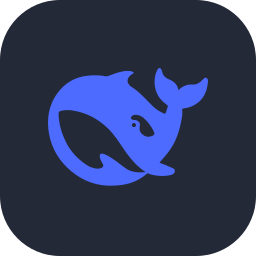

# Hi, I'm TCK

### A student.

  

- 🌱 I'm currently learning **C++、C#、Python、Bash、CyberSecurity**

- 📝 I write articles on **[https://tck-blog.pages.dev/](https://tck-blog.pages.dev/)**

<h3 align="left">Systems:</h3>

<h3 align="left">Languages:</h3>

<h3 align="left">AI:</h3>

<h3 align="left">Agents:</h3>

<h3 align="left">Frameworks:</h3>

<h3 align="left">Tools:</h3>

<h3 align="left">Connect with me:</h3>

